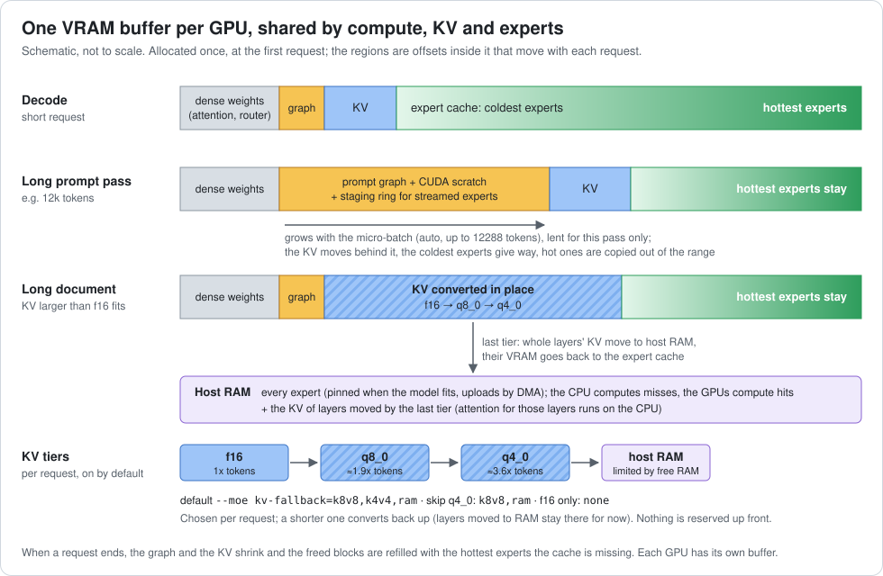

# Rocket LLama 


# A bit experimental, slightly faster ... 
up to 25x faster prefill and 2.5x decode on big models 

Fork of llama.cpp with multi gpu acceleration even for models bigger than total gpu mem. 
But even on single 5090 20x pp and 2x t gains 

Most of the gain comes from using the VRAM better, not from the second GPU: the 20x prompt speed on MiMo happens on one card. A second card adds 15% to 26% on prompts of 11k tokens and more.

**Who gains:** mixture-of-experts models larger than the VRAM. The less of the model fits, the bigger the gain: 4x to 25x prompt speed and 1.2x to 2.5x decode over stock llama.cpp on the models below, and 22x decode on DeepSeek 4.1, which does not even fit in the RAM. Dense models and models that fit in VRAM run at stock speed.

## Best gainers

Only gains of 1.2x and more. Ours against the official stock binary of the same day (stock build column); both on one machine: 2x RTX 3090 (one x16 and one x4 slot, 280 W and 220 W), Ryzen 7 3700X, 128 GB DDR4-3200.

| model | file (GiB) | in 48 GiB of VRAM (%) | best prompt gain | best decode gain |
|---|---|---|---|---|
| MiMo 2.6 Flash 3-bit | 107.7 | 45 | **25.1x** (12k prompt) | **2.47x** (short prompt) |
| DeepSeek 4.1 Flash IQ2_XXS* | 232 | 21 | **8.6x** (3k prompt) | **22.4x** (short prompt) |
| GLM 5.3 Flash 3.0-bit | 109.4 | 44 | **20.9x** (16k prompt) | **1.69x** (short prompt) |
| GLM 5.3 Flash 3.5-bit* | 127.7 | 38 | **17.9x** (12k prompt) | **1.59x** (short and 3k prompts) |
| Qwen 3.8 Next IQ4_XS | 87.2 | 55 | **9.2x** (16k prompt) | **1.78x** (short prompt) |
| Qwen 3.8 Next IQ3_S | 77.8 | 62 | **4.6x** (3k prompt) | **1.31x** (short prompt) |

Every measured cell, sorted by its bigger gain. Decode = generated tokens per second, prompt = prompt tokens per second, gain = ours / stock; each cell links both answers.

| model | test | stock decode (t/s) | ours decode (t/s) | decode gain | stock prompt (t/s) | ours prompt (t/s) | prompt gain | our build | stock build | answers |
|---|---|---|---|---|---|---|---|---|---|---|
| MiMo 2.6 Flash 3-bit | 12k/1k | 13.99 | **25.71** | **1.84x** | 49.4 | **1241.1** | **25.1x** | b14965 | b11829 | [ours](fork/outputs/24369.txt), [stock](fork/outputs/18221s.txt) |
| MiMo 2.6 Flash 3-bit | 16k/64† | 13.73 | **26.67** | **1.94x†** | 48.6 | **1123.9** | **23.1x** | b13954 | b11887 | [ours](fork/outputs/19204.txt), [stock](fork/outputs/19571s.txt) |
| DeepSeek 4.1 Flash IQ2_XXS* | short/1k | 1.47 | **32.95** | **22.4x** | - | - | - | b14939 | b11887 | [ours](fork/outputs/24094.txt), [stock](fork/outputs/19818s.txt) |
| GLM 5.3 Flash 3.0-bit | 16k/1k† | 12.53 | **19.56** | **1.56x†** | 41.7 | **869.6** | **20.9x** | b14939 | b11887 | [ours](fork/outputs/24065.txt), [stock](fork/outputs/19572s.txt) |
| DeepSeek 4.1 Flash IQ2_XXS* | 3k/1k | 1.46 | **26.25** | **18.0x** | 39.1 | **336.4** | **8.6x** | b14939 | b11887 | [ours](fork/outputs/24092.txt), [stock](fork/outputs/19814s.txt) |
| GLM 5.3 Flash 3.5-bit* | 12k/1k | 10.72 | **15.18** | **1.42x** | 34.3 | **614.9** | **17.9x** | b14954 | b11829 | [ours](fork/outputs/24296.txt), [stock](fork/outputs/18275s.txt) |
| GLM 5.3 Flash 3.0-bit | 12k/1k | 12.8 | **19.8** | **1.55x** | 43 | **689** | **16.2x** | b13838 | b11829 | [ours](fork/outputs/18209.txt), [stock](fork/outputs/18232s.txt) |
| MiMo 2.6 Flash 3-bit | 3k/1k | 14.1 | **31.6** | **2.24x** | 48 | **754** | **15.6x** | b13838 | b11829 | [ours](fork/outputs/18199.txt), [stock](fork/outputs/18223s.txt) |
| GLM 5.3 Flash 3.0-bit | 3k/1k | 12.7 | **20.2** | **1.59x** | 40 | **617** | **15.4x** | b13838 | b11829 | [ours](fork/outputs/18211.txt), [stock](fork/outputs/18235s.txt) |
| GLM 5.3 Flash 3.5-bit* | 3k/1k | 10.70 | **17.05** | **1.59x** | 32.5 | **465.7** | **14.3x** | b14940 | b11829 | [ours](fork/outputs/24158.txt), [stock](fork/outputs/18277s.txt) |
| DeepSeek 4.1 Flash IQ2_XXS* | 16k/1k | 1.46 | **18.60** | **12.7x** | 42.5 | **347.9** | **8.2x** | b14563 | b11887 | [ours](fork/outputs/22095.txt), [stock](fork/outputs/19809s.txt) |
| Qwen 3.8 Next IQ4_XS | 16k/1k† | 31.98 | **50.98** | **1.59x†** | 207.9 | **1907.5** | **9.2x** | b14939 | b11887 | [ours](fork/outputs/24059.txt), [stock](fork/outputs/19568s.txt) |
| Qwen 3.8 Next IQ4_XS | 12k/1k | 32.6 | **52.7** | **1.62x** | 213 | **1902** | **8.9x** | b13838, b14020 | b11829 | [ours](fork/outputs/18203.txt), [ours](fork/outputs/19588.txt), [stock](fork/outputs/18227s.txt) |
| Qwen 3.8 Next IQ4_XS | 4k/64† | 30.22 | **53.92** | **1.78x†** | 209.5 | **1705.0** | **8.1x** | b13964 | b11887 | [ours](fork/outputs/19270.txt), [stock](fork/outputs/19567s.txt) |
| Qwen 3.8 Next IQ4_XS | 3k/1k | 32.1 | **54.9** | **1.71x** | 209 | **1339** | **6.4x** | b13842 | b11829 | [ours](fork/outputs/18381.txt), [stock](fork/outputs/18228s.txt) |
| Qwen 3.8 Next IQ3_S | 3k/1k | 44.59 | **56.18** | **1.26x** | 387.2 | **1777.2** | **4.6x** | b14939 | b11829 | [ours](fork/outputs/24122.txt), [stock](fork/outputs/18270s.txt) |
| Qwen 3.8 Next IQ3_S | 12k/1k | 43.8 | **53.6** | **1.22x** | 372 | **1477** | **4.0x** | b13586 | b11742 | [ours](fork/outputs/16719.txt), [stock](fork/outputs/17094s.txt) |
| MiMo 2.6 Flash 3-bit | short/1k | 14.1 | **34.8** | **2.47x** | - | - | - | b13838 | b11829 | [ours](fork/outputs/18201.txt), [stock](fork/outputs/18225s.txt) |
| Qwen 3.8 Next IQ4_XS | short/1k | 30.9 | **55.1** | **1.78x** | - | - | - | b13586 | b11742 | [ours](fork/outputs/16788.txt), [stock](fork/outputs/17114s.txt) |
| GLM 5.3 Flash 3.0-bit | short/1k | 12.7 | **21.6** | **1.69x** | - | - | - | b13838 | b11829 | [ours](fork/outputs/18213.txt), [stock](fork/outputs/18236s.txt) |
| GLM 5.3 Flash 3.5-bit* | short/1k | 10.7 | **17.1** | **1.59x** | - | - | - | b13842 | b11829 | [ours](fork/outputs/18431.txt), [stock](fork/outputs/18279s.txt) |
| Qwen 3.8 Next IQ3_S | short/1k | 43.5 | **56.9** | **1.31x** | - | - | - | b13563 | b11742 | [ours](fork/outputs/16766.txt), [stock](fork/outputs/17102s.txt) |

- **Tests:** 12k/1k = a 12.4k-13.8k-token code review prompt, 1024 tokens out; 16k/1k = the same review at 16k tokens; 3k/1k = a ~3k-token source file and an edit instruction, up to 1024 tokens out; short/1k = a one-line prompt, 1024 tokens out (too short to time the prompt).
- **†** stock was asked for 64 tokens there, fewer than the 256 a decode speed is taken from: that decode gain is for information, the prompt gain stands.
- **\*** larger than this machine's 128 GB RAM. GLM 3.5-bit runs partly from the SSD. DeepSeek 4.1 runs mostly from it: stock reads it through the page cache at about 1.5 t/s; ours keeps the hot experts in VRAM and in a pinned RAM pool and reads the rest from the SSD with direct I/O.
- **Valid runs only:** the same power limits for both sides, answer not looped, decode speed only from answers of 256 tokens or more; speeds as the server reports them. Each row is the best valid run among our builds (our build column) against the stock run closest to stock's median. The answers are in [fork/outputs](fork/outputs) (header: build, test, speeds, arguments, power).

Older tables, the two-card split study, per-feature A/B tests and the perplexity tables: [fork/docs/perf-history.md](fork/docs/perf-history.md).

## Quick start

Download the archive for your system from the [latest release](https://github.com/neurall/llama.cpp/releases/latest):

- **Windows:** one zip with CPU, CUDA, Vulkan and HIP, their runtimes included.
- **Linux:** the tarball (CPU, CUDA, Vulkan, HIP), plus the `cudart-` archive for NVIDIA cards when CUDA 13 is not installed. HIP on Linux needs ROCm 7 or newer installed; without it CUDA, Vulkan and the CPU work as before.

```sh
llama-server -m MiMo-V2.6-Flash-RL-GSQ-RCO-3bit.gguf -np 1
```

Nothing else is needed. For a MoE model larger than the free VRAM, the expert placement, the cache size, the micro-batch, the context, the KV type and the threads are chosen at start and printed (`-lv 5` prints all of them). Settings you pass win: `--moe-expert-cache 0` turns the cache off, and your own `-ngl`, `-ot` or `--cpu-moe` keep it off unless you add `--moe-expert-cache -1`. Every `--moe` key: [fork/docs/fork-knobs.md](fork/docs/fork-knobs.md).

## How it works



- **VRAM is an expert cache.** A token of a MoE model uses a few of the hundreds of experts in each layer. Stock fills the VRAM with whole layers, mostly experts the current token does not touch. Here each GPU's free VRAM is one pool of expert blocks for all layers, holding the experts the tokens actually use. Which ones are hot is learned per model and kept between runs in `moe-state.ini`.
- **RAM and SSD hold the rest.** A model that fits in the RAM is pinned whole, so uploads to the GPU run at full PCIe speed. A larger one keeps its hottest experts in a pinned RAM pool and reads the others from the SSD with direct I/O, past the page cache.
- **Decode:** the GPUs compute the cached experts while the CPU computes the rest, in parallel.
- **Prompts in few big passes.** The compute buffer of a big pass is lent from the expert cache only while the pass runs; decode gets the space back. The experts a GPU does not hold are streamed for the pass, either all of them or only those the routers pick, predicted one layer ahead; a planner measures which is faster for each pass size.
- **KV from the same VRAM.** With `-np 1` each request claims the KV it needs and returns it at its end, so no `-c` has to be guessed. A request that needs more converts its KV to q8_0, then q4_0, then moves layers of it to the RAM.
- **Two GPUs.** Per prompt, one card or the dense layers split over both, from each card's measured link speed and compute.
- **Fast start** (Linux, CUDA, a model that fits in the RAM). The weights are read with direct I/O at the queue depth measured for the drive, while the buffers read before are already being pinned (GLM 5.3 3.0-bit: the server answers after 37 s instead of 69 s).

Internals and measurements per feature: [fork/docs/features.md](fork/docs/features.md).

## Known limits

- **One machine behind the table:** 2x RTX 3090 (x16 + x4 slots), Ryzen 7 3700X, 128 GB DDR4. Vulkan is measured on an RTX 4060 and a Radeon 780M (Windows), on Linux only load-tested; other GPUs and setups with 3 or more GPUs are untested. Reports with the startup log (`-lv 5`) are welcome.
- **The first runs of a new model are slower:** the hot experts are learned from use. A pre-warmed state for the models above: copy [fork/moe-state.ini](fork/moe-state.ini) to `~/.cache/llama.cpp/` (Windows: `%LOCALAPPDATA%\llama.cpp\`).
- **A model larger than the RAM** runs partly from the SSD, so the drive's speed shows in its numbers.
- **Output can differ between runs at temperature 0:** a cached expert runs on the GPU, a missed one on the CPU, and they round slightly differently. `--moe fixed=1` makes a build repeat its output.
- **Quality:** perplexity equals stock within noise on every model measured (DeepSeek 4.1 -0.02%, GLM 5.3 3.0-bit -0.27%, 3.5-bit -0.37%, MiMo 0.00%, Qwen 3.8 Next IQ4_XS 0.00%; 9 to 12 chunks of 1024 tokens). Tables and method: [fork/docs/perf-history.md](fork/docs/perf-history.md).

**Reproduce the table** with the harness (stock and ours, 2 runs per cell; paths in [fork/local.toml.example](fork/local.toml.example), model files in [fork/models.ini](fork/models.ini)): `python3 fork/run.py run -c gainers -sc -nrt -from-best -r 2`. `-sc` runs each cell on the newest official stock binary first (pulled, never built). The exact requests: [fork/bench](fork/bench) `req-*.json`.


## Credits and thanks

- **Georgi Gerganov ([ggerganov](https://github.com/ggerganov)) and every contributor to [llama.cpp](https://github.com/ggml-org/llama.cpp) and ggml**: this fork is a small layer on a fantastic project that has given so much to so many people for so many years. Thank you.
- **[@csantiago78](https://github.com/csantiago78)** and their pull request [#27861](https://github.com/ggml-org/llama.cpp/pull/27861) ("GPU-resident LRU cache for host-offloaded MoE expert weights"), the starting point of this fork's expert cache. It has since diverged (window and admission instead of LRU, one global pool instead of fixed slots per layer), but the idea and the first working version are theirs.
- **People who tried this fork and reported back**: [@MichaelDietzel](https://github.com/MichaelDietzel) (tested on a 2080 Ti and asked for documentation of the `--moe` keys and of multi-GPU use), [@Volunteer-1](https://github.com/Volunteer-1) (Windows build report and the same documentation questions; every flag is now documented in [fork/docs/fork-knobs.md](fork/docs/fork-knobs.md)), [@homeofe](https://github.com/homeofe) (the small-VRAM data point where the cache was slower than stock, and the AVX2 dot products for IQ3_S and IQ3_XXS in `ggml-cpu`, merged into this fork, MIT license) and [@yuffx](https://github.com/yuffx) (the PCIe-bound explanation of that result).

---

*The original llama.cpp README follows below.*

---

# llama.cpp


<div align="center">

<b>LLM inference in C/C++</b>

[](https://opensource.org/licenses/MIT)
[](https://github.com/ggml-org/llama.cpp/releases?q=tag:v0)
[](https://github.com/ggml-org/llama.cpp/releases?q=b)
[](https://github.com/ggml-org/llama.cpp/actions/workflows/server.yml)
[](https://github.com/ggml-org/llama.cpp/actions/workflows/docker.yml)
[](https://github.com/ggml-org/llama.cpp/actions/workflows/winget.yml)

[ggml](https://github.com/ggml-org/ggml) / [ops](https://github.com/ggml-org/llama.cpp/blob/master/docs/ops.md) / [maintainer PRs](https://github.com/ggml-org/llama.cpp/pulls?q=is%3Apr%20is%3Aopen%20draft%3AFalse%20(author%3Asanmai%20OR%20author%3Argerganov%20OR%20author%3AKitaitiMakoto%20OR%20author%3Adanbev%20OR%20author%3Aaldehir%20OR%20author%3Amax-krasnyansky%20OR%20author%3ACISC%20OR%20author%3Aggerganov%20OR%20author%3Aam17an%20OR%20author%3Ajhen0409%20OR%20author%3Abartowski1182%20OR%20author%3Anikwen%20OR%20author%3Ahipudding%20OR%20author%3Aravi9%20OR%20author%3AServeurpersoCom%20OR%20author%3Athelittlefireman%20OR%20author%3Apwilkin%20OR%20author%3Areeselevine%20OR%20author%3Angxson%20OR%20author%3Ajeffbolznv%20OR%20author%3Amarty1885%20OR%20author%3A0cc4m%20OR%20author%3ATitaniumtown%20OR%20author%3Aangt%20OR%20author%3AIMbackK%20OR%20author%3Aarthw%20OR%20author%3AJohannesGaessler%20OR%20author%3AORippler%20OR%20author%3Aruixiang63%20OR%20author%3Axctan%20OR%20author%3AmasterFoad%20OR%20author%3Aallozaur%20OR%20author%3AAndreas-Krebbel%20OR%20author%3Ayomaytk%20OR%20author%3Aaendk%20OR%20author%3Awine99%20OR%20author%3Agaugarg-nv%20OR%20author%3Ataronaeo%20OR%20author%3Aforforever73%20OR%20author%3Achaxu01%20OR%20author%3Alhez%20OR%20author%3AAlekseiNikiforovIBM%20OR%20author%3Anetrunnereve%20OR%20author%3Afairydreaming%20OR%20author%3Aynankani)%20sort%3Aupdated-desc) / [dev stats](https://github.com/ggml-org/llama.cpp-dev) / [lib llama API](https://github.com/ggml-org/llama.cpp/issues/9289) / [llama-server REST API](https://github.com/ggml-org/llama.cpp/issues/9291)

</div>

## Quick start

A few options to get `llama.cpp` installed on your machine:

```bash
# curl
curl -LsSf https://llama.app/install.sh | sh

# powershell
irm https://llama.app/install.ps1 | iex
```

- Visit https://llama.app and follow the instructions
- Run with Docker - see our [Docker documentation](docs/docker.md)
- Download pre-built binaries from the [releases page](https://github.com/ggml-org/llama.cpp/releases)
- Build from source by cloning this repository - check out [our build guide](docs/build.md)

Once installed:

```sh
# Download and run a model directly from Hugging Face
llama cli -hf ggml-org/Qwen3.5-0.8B-GGUF

# Launch OpenAI-compatible API server
llama serve -hf ggml-org/Qwen3.5-0.8B-GGUF
```

<table align="center">
    <tr>
        <td align="center" width=50%>
            
            <i>VLM session with <b>llama cli</b></i>
        </td>
        <td align="center">
            
            <i>Built-in web UI against <b>llama serve</b></i>
        </td>
    </tr>
<table>

## Description

The main goal of `llama.cpp` is to enable LLM (and VLM) inference with minimal setup and state-of-the-art performance on
a wide range of hardware - locally and in the cloud.

- Plain C/C++ implementation without any dependencies
- Apple silicon is a first-class citizen - optimized via ARM NEON, Accelerate and Metal frameworks
- AVX, AVX2, AVX512 and AMX support for x86 architectures
- RVV, ZVFH, ZFH, ZICBOP and ZIHINTPAUSE support for RISC-V architectures
- 1.5-bit, 2-bit, 3-bit, 4-bit, 5-bit, 6-bit, and 8-bit integer quantization for faster inference and reduced memory use
- Custom CUDA kernels for running LLMs on NVIDIA GPUs (support for AMD GPUs via HIP and Moore Threads GPUs via MUSA)
- Vulkan and SYCL backend support
- CPU+GPU hybrid inference to partially accelerate models larger than the total VRAM capacity

The `llama.cpp` project is build on top of the [ggml](https://github.com/ggml-org/ggml) library.

## Supported backends

| Backend | Target devices |
| --- | --- |
| [BLAS](docs/build.md#blas-build) | All |
| [BLIS](docs/backend/BLIS.md) | All |
| [CANN](docs/build.md#cann) | Huawei Ascend NPU |
| [CUDA](docs/build.md#cuda) | Nvidia GPU |
| [HIP](docs/build.md#hip) | AMD GPU |
| [Hexagon](docs/backend/snapdragon/README.md) | Snapdragon |
| [IBM zDNN](docs/backend/zDNN.md) | IBM Z & LinuxONE |
| [MUSA](docs/build.md#musa) | Moore Threads GPU |
| [Metal](docs/build.md#metal-build) | Apple Silicon |
| [OpenCL](docs/backend/OPENCL.md) | Adreno GPU |
| [OpenVINO [In Progress]](docs/backend/OPENVINO.md) | Intel CPUs, GPUs, and NPUs |
| [RPC](https://github.com/ggml-org/llama.cpp/tree/master/tools/rpc) | All |
| [SYCL](docs/backend/SYCL.md) | Intel GPU |
| [VirtGPU](docs/backend/VirtGPU.md) | VirtGPU APIR |
| [Vulkan](docs/build.md#vulkan) | GPU |
| [WebGPU](docs/build.md#webgpu) | All |
| [ZenDNN](docs/build.md#zendnn) | AMD CPU |

## Documentation

#### Tools

- [cli](tools/cli/README.md)
- [completion](tools/completion/README.md)
- [server](tools/server/README.md)
- [GBNF grammars](grammars/README.md)

#### Development

- [How to build](docs/build.md)
- [Running on Docker](docs/docker.md)
- [Build on Android](docs/android.md)
- [Multi-GPU usage](docs/multi-gpu.md)
- [Performance troubleshooting](docs/development/token_generation_performance_tips.md)
- [GGML tips & tricks](https://github.com/ggml-org/llama.cpp/wiki/GGML-Tips-&-Tricks)
- [XCFramework](docs/xcframework.md)
- [Completions](docs/completions.md)
- [Models](docs/models.md)
- [Release process](docs/release.md)

## Contributing

- Contributors can open PRs
- Collaborators will be invited based on contributions
- Maintainers can push to branches in the `llama.cpp` repo and merge PRs into the `master` branch
- Any help with managing issues, PRs and projects is very appreciated!
- Read the [CONTRIBUTING.md](CONTRIBUTING.md) for more information

## Acknowledgements

- [yhirose/cpp-httplib](https://github.com/yhirose/cpp-httplib) - Single-header HTTP server, used by `llama-server` - MIT license
- [nothings/stb](https://github.com/nothings/stb) - Single-header image format decoder, used by multimodal subsystem - Public domain
- [nlohmann/json](https://github.com/nlohmann/json) - Single-header JSON library, used by various tools/examples - MIT License
- [mackron/miniaudio](https://github.com/mackron/miniaudio) - Single-header audio format decoder, used by multimodal subsystem - Public domain
- [sheredom/subprocess.h](https://github.com/sheredom/subprocess.h) - Single-header process launching solution for C and C++ - Public domain
