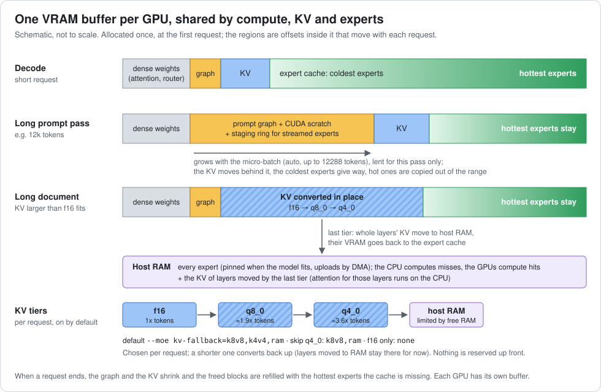

# Rocket LLama 


# up to 20x faster prefill and 2.4x decode on big models 

Fork of llama.cpp with multi gpu acceleration even for models bigger than total gpu mem. 
But even on single 5090 20x pp and 2x t gains 


In other words tha gains you see bellow are not from multigpu yet just from more efficient vram mmgmt
ie the same 20x speedup in mimo is happening on single 5090 too.

```sh
llama-server -m MiMo-V2.6-Flash-RL-GSQ-RCO-3bit.gguf
```

**Support:** if this fork helps you, please support my open-source development (nothing fancy, just rent, food and hardware): [paypal.me/neuralll](https://paypal.me/neuralll)

**Download:** the [latest release](https://github.com/neurall/llama.cpp/releases/latest) has one package per OS with CPU, CUDA, Vulkan and HIP backends (Linux `tar.gz`, Windows `zip`). NVIDIA cards also need the `cudart-` archive if CUDA 13 is not installed.

## Results

Each row: the official upstream binary (stock, its own defaults, `-np 1`) against this fork, same machine, same request, same day. **12k/1k** = 12.4k-13.8k-token code-review prompt, 1024 tokens out; **3k/1k** = about 3k-token source file plus an edit instruction, answer up to 1024 tokens; **short/1k** = one-line prompt, 1024 tokens out (too short to time the prompt). Decode = generated tokens/s, prompt = prompt tokens/s. Every answer is stored in [fork/outputs](fork/outputs) (`<id>.txt` ours, `<id>s.txt` stock).

One run of ours (the best valid run among our builds; the build column names it) against the official stock run of the same cell closest to stock's median (the stock column names its version; stock binaries are pulled, never built). Every number is from those two runs, whose answers are in the output column (ours on top, stock below, so you can open both). Sorted by the bigger gain; rows where neither gain reaches +10% are left out (models that fit in VRAM and the dense 27B models run at stock speed). Upper number stock, lower ours. **12k/1k** = 12.4k-13.8k-token code-review prompt, 1024 tokens out; **15k/1k** = the same review at 15.5k tokens; **16k/1k** = the same review at 16k tokens; **3k/1k** = ~3k-token source file plus an edit instruction, answer up to 1024 tokens; **short/1k** = one-line prompt, 1024 tokens out (no prompt speed: too short to time). t/s = decode, pp = prompt processing, ppl = perplexity on b13600 (details below; - = not measured for that build). Valid = same power limits as stock (x4 card 220 W, x16 card 280 W), answer not looped, decode only from answers of 256+ tokens. 2x RTX 3090 (x16 + x4), Ryzen 7 3700X, 128 GB DDR4-3200.

| model | test | t/s | pp | gain t | gain pp | ppl | build | stock | output |
|---|---|---|---|---|---|---|---|---|---|
| MiMo 2.6F 3-bit | 12k/1k | 13.99<br>25.71 | 49.4<br>1241.1 | +84% | +2412% 25.1x | -<br>- | **b14965** | b11829 | [24369](fork/outputs/24369.txt)<br>[18221s](fork/outputs/18221s.txt) |
| MiMo 2.6F 3-bit | 16k/64† | 13.73<br>26.67 | 48.6<br>1123.9 | +94% 1.94x† | +2212% 23.12x | -<br>- | b13954 | b11887 | [19204](fork/outputs/19204.txt)<br>[19571s](fork/outputs/19571s.txt) |
| DeepSeek 4.1 IQ2_XXS* | short/1k | 1.47<br>32.95 | -<br>- | +2141% 22.4x | - | -<br>- | b14939 | b11887 | [24094](fork/outputs/24094.txt)<br>[19818s](fork/outputs/19818s.txt) |
| MiMo 2.6F 3-bit, 1× RTX 5090 | 12k/1k | 6.83<br>36.13 | 141.3<br>3016.3 | +429% 5.3x | +2035% 21.3x | -<br>- | b13348 | b11799 | [14701](fork/outputs/14701.txt)<br>[14700s](fork/outputs/14700s.txt) |
| GLM 5.3 3-bit | 16k/1k† | 12.53<br>19.56 | 41.7<br>869.6 | +56%† | +1985% 20.9x | -<br>- | b14939 | b11887 | [24065](fork/outputs/24065.txt)<br>[19572s](fork/outputs/19572s.txt) |
| DeepSeek 4.1 IQ2_XXS* | 3k/1k | 1.46<br>26.25 | 39.1<br>336.4 | +1698% 18.0x | +760% 8.6x | -<br>- | b14939 | b11887 | [24092](fork/outputs/24092.txt)<br>[19814s](fork/outputs/19814s.txt) |
| GLM 5.3 3.5-bit* | 12k/1k | 10.72<br>15.18 | 34.3<br>614.9 | +42% | +1693% 17.9x | -<br>- | b14954 | b11829 | [24296](fork/outputs/24296.txt)<br>[18275s](fork/outputs/18275s.txt) |
| GLM 5.3 3-bit | 12k/1k | 12.8<br>19.8 | 43<br>689 | +55% | +1518% 16.2x | 1.7626<br>1.7578 | b13838 | b11829 | [18209](fork/outputs/18209.txt)<br>[18232s](fork/outputs/18232s.txt) |
| MiMo 2.6F 3-bit | 3k/1k | 14.1<br>31.6 | 48<br>754 | +124% 2.2x | +1460% 15.6x | 1.8758<br>1.8758 | b13838 | b11829 | [18199](fork/outputs/18199.txt)<br>[18223s](fork/outputs/18223s.txt) |
| GLM 5.3 3-bit | 3k/1k | 12.7<br>20.2 | 40<br>617 | +59% | +1443% 15.4x | 1.7626<br>1.7578 | b13838 | b11829 | [18211](fork/outputs/18211.txt)<br>[18235s](fork/outputs/18235s.txt) |
| GLM 5.3 3.5-bit* | 3k/1k | 10.70<br>17.05 | 32.5<br>465.7 | +59% | +1333% 14.3x | -<br>- | b14940 | b11829 | [24158](fork/outputs/24158.txt)<br>[18277s](fork/outputs/18277s.txt) |
| DeepSeek 4.1 IQ2_XXS* | 16k/1k | 1.46<br>18.60 | 42.5<br>347.9 | +1174% 12.7x | +719% 8.2x | -<br>- | b14563 | b11887 | [22095](fork/outputs/22095.txt)<br>[19809s](fork/outputs/19809s.txt) |
| Qwen 3.8 Next IQ4_XS | 15k/1k | 29.14<br>52.31 | 176.8<br>1934.1 | +80% | +994% 10.9x | -<br>- | b13845, b14705 | b12131 | [23477](fork/outputs/23477.txt), [23510](fork/outputs/23510.txt)<br>[23452s](fork/outputs/23452s.txt) |
| Qwen 3.8 Next IQ4_XS | 16k/1k† | 31.98<br>50.98 | 207.9<br>1907.5 | +59%† | +818% 9.2x | -<br>- | b14939 | b11887 | [24059](fork/outputs/24059.txt)<br>[19568s](fork/outputs/19568s.txt) |
| Qwen 3.8 Next IQ4_XS | 12k/1k | 32.6<br>52.7 | 213<br>1902 | +62% | +793% 8.9x | 1.4101<br>1.4101 | b13838, b14020 | b11829 | [18203](fork/outputs/18203.txt), [19588](fork/outputs/19588.txt)<br>[18227s](fork/outputs/18227s.txt) |
| Qwen 3.8 Next IQ4_XS | 4k/64† | 30.22<br>53.92 | 209.5<br>1705.0 | +78% 1.78x† | +714% 8.14x | -<br>- | b13964 | b11887 | [19270](fork/outputs/19270.txt)<br>[19567s](fork/outputs/19567s.txt) |
| Qwen 3.8 Next IQ4_XS | 3k/1k | 32.1<br>54.9 | 209<br>1339 | +71% | +542% 6.4x | 1.4101<br>1.4101 | b13842 | b11829 | [18381](fork/outputs/18381.txt)<br>[18228s](fork/outputs/18228s.txt) |
| Qwen 3.8 Next IQ3_S | 3k/1k | 44.59<br>56.18 | 387.2<br>1777.2 | +26% | +359% 4.6x | -<br>- | b14939 | b11829 | [24122](fork/outputs/24122.txt)<br>[18270s](fork/outputs/18270s.txt) |
| Qwen 3.8 Next IQ3_S | 12k/1k | 43.8<br>53.6 | 372<br>1477 | +22% | +297% 4.0x | 1.3927<br>1.3927 | b13586 | b11742 | [16719](fork/outputs/16719.txt)<br>[17094s](fork/outputs/17094s.txt) |
| MiMo 2.6F 3-bit | short/1k | 14.1<br>34.8 | -<br>- | +147% 2.5x | - | 1.8758<br>1.8758 | b13838 | b11829 | [18201](fork/outputs/18201.txt)<br>[18225s](fork/outputs/18225s.txt) |
| Qwen 3.8 Next IQ4_XS | short/1k | 30.9<br>55.1 | -<br>- | +78% | - | 1.4101<br>1.4101 | b13586 | b11742 | [16788](fork/outputs/16788.txt)<br>[17114s](fork/outputs/17114s.txt) |
| GLM 5.3 3-bit | short/1k | 12.7<br>21.6 | -<br>- | +69% | - | 1.7626<br>1.7578 | b13838 | b11829 | [18213](fork/outputs/18213.txt)<br>[18236s](fork/outputs/18236s.txt) |
| GLM 5.3 3.5-bit* | short/1k | 10.7<br>17.1 | -<br>- | +59% | - | 1.6326<br>1.6265 | b13842 | b11829 | [18431](fork/outputs/18431.txt)<br>[18279s](fork/outputs/18279s.txt) |
| Qwen 3.8 Next IQ3_S | short/1k | 43.5<br>56.9 | -<br>- | +31% | - | 1.3927<br>1.3927 | b13563 | b11742 | [16766](fork/outputs/16766.txt)<br>[17102s](fork/outputs/17102s.txt) |

† Rows with a 64-token answer (/64): stock was asked for 64 tokens, below the 256 tokens a decode speed is taken from, so the decode gain of these rows is for information; the prompt gain stands. The new rows show the best decode speed and the best prompt speed among the runs of the cell (what the run list prints, two decimals); the linked answer is one of those runs, so its header can show a slower speed than the table.  
16k/1k†: ours answered 1024 tokens, stock was asked for 64 there, so the decode gain of those rows is for information too.  
Rows marked **1× RTX 5090**: a rented cloud server (2× EPYC 9J14, 760 GB RAM, one RTX 5090 at PCIe 5 x16), 2026-10-21, stock and ours minutes apart. All other rows: Ryzen 7 3700X, 128 GB DDR4, 2× RTX 3090 (the second at x4).  
\* GLM 3.5-bit (127.7 GiB) is larger than this machine's 128 GB RAM, so part of it runs from the SSD and the system swaps (up to about 4 GiB of swap in use during runs). Ours is faster than stock despite that.  
\* DeepSeek 4.1 IQ2_XXS (232 GiB) is far larger than the 128 GB RAM: stock reads it through the page cache at about 1.5 t/s; ours keeps the hot experts in VRAM and a pinned RAM pool and reads the rest from the SSD (O_DIRECT).  

## Where the speed comes from

Our builds in the table: b14965 (this release, no-mmap), b14939-b14954 (its candidate builds of 2026-11-08, same engine line), b14563 (2026-11-02), and older rows from b13563-b14020 that newer builds did not beat by 5% or more. b13348 (2026-10-21) is the 1× RTX 5090 row, against stock b11799 of the same day; b13845 and b14705 (2026-11-05/06) are the 15k/1k row, against stock b12131 (2026-11-05). Stock versions differ per row (stock column): b11742 (2026-10-20), b11829 (2026-10-23), b11866 and b11887 (2026-10-24/26), each the newest official stock on the day of its row. Older tables (earlier releases, laptop and CPU rows): [fork/docs/perf-history.md](fork/docs/perf-history.md).

### Reproduce a row

1. Binaries: ours (Windows zip on the add the `cudart-` archive if CUDA 13 is not installed); stock: `llama-b11829-bin-ubuntu-cuda-13.4-x64.tar.gz` from [ggml-org b11829](https://github.com/ggml-org/llama.cpp/releases/tag/b11829) for the b13838/b13842 rows, `llama-b11742-bin-ubuntu-cuda-13.4-x64.tar.gz` from [ggml-org b11742](https://github.com/ggml-org/llama.cpp/releases/tag/b11742) for the older rows.
2. Start the server (port 9931). The `-c` values are the ones the table's runs used:

| test | ours | stock |
|---|---|---|
| **Prompt passes on the GPUs** | Experts the GPU does not hold are streamed to it during the prompt, in passes of up to 16k tokens, so every upload serves many tokens; stock computes them on the CPU | 16x-23x prompt speed on GLM and MiMo on the previous machine (stock 42-49 prompt t/s, ours 700-1150), 12.6x on the current one (MiMo 12k: 115.6 to 1458 prompt t/s); micro-batch 1024 to 4096 alone: 2.1x (GLM 12k: 176.6 to 370.1 prompt t/s) |
| **Expert cache in free VRAM (VRAM hot map)** | All free VRAM becomes one pool of expert blocks shared by all layers; the experts the tokens use most stay there, misses run on the CPU in parallel | decode +20% to +150% against stock on models that do not fit (table above); global pool against fixed slots per layer +2-4% |
| **Learned hot map kept between runs** | Each expert's lifetime use is saved per model (`moe-state.ini`) and preloaded at the next start; after a prompt, the blocks it borrowed are refilled with the hottest experts | first request after a restart +4-6% decode; decode after a 12k prompt +12.7% (cache hits 43% to 55%) |
| **RAM pool with direct SSD reads (RAM hot map)** | Experts live in a pinned RAM pool sized from free memory; experts outside it are read from the SSD with direct I/O, never through the page cache or a file mapping | DeepSeek generation +29-31%, first short prompt after a start 3-5x, MiMo edit prompt +28% (b14965 against b14929); models larger than RAM run at all |
| **Dynamic context and KV in the same pool** | No context is reserved: each request claims the KV it needs from the same VRAM as the experts and gives it back; if it does not fit, the KV converts in place to q8_0, then q4_0, then moves layers to RAM | no `-c` to guess; prompts that stock refuses at its automatic context (30k, 60k) run at full speed; MiMo 200k-token prompt 794 prompt t/s, 400k 363 prompt t/s; Qwen3.6-35B 200k 3259 prompt t/s; q8_0 KV perplexity within noise of f16 |
| **Compute buffer lent per pass** | The large prompt micro-batch borrows expert-cache blocks only for the pass and returns them for generation | +6.6% decode after a long prompt at the same prompt speed |
| **Dense split over several GPUs** | Tensor-parallel split of the dense (attention, shared) layers over the cards for long prompts, experts streamed to each card, chosen per request by a planner from measured link and compute speed | prompt speed at 60k tokens: Qwen3.6-35B +44% (2890 to 4169 prompt t/s), Qwen3.8 IQ3_S +25%, GLM-5.3 3.0-bit +23-25%; GLM 12k +35-70% (b14965); MiMo 200k +39% |
| **Expert split over several GPUs** | Each card computes its share of every layer's experts (MoE tensor parallelism), for models that do not fit the cards' memory | Qwen3.8 IQ4_XS 12k on 8 GiB cards: +19-23% prompt speed over one card (development build, next release) |
| **Next-layer prediction** | The next layer's router runs early on the current layer's input, so the upload of its experts starts while the current layer computes | 79% of the next layer's experts found in its predicted top 8, 94% in its top 16 |
| **Faster start** | Weights read with direct I/O at the drive's measured queue depth while earlier buffers are pinned | GLM-5.3 3.0-bit 69 s to 37 s until the server answers, DeepSeek-V4.1 71 s to 49.5 s (b15065) |

To our knowledge no other engine splits the dense layers and the experts of a model over several GPUs when the model does not fit in their memory: upstream llama.cpp splits only the layers that fit, and vLLM and SGLang expect the model in VRAM.



Older measurements and the per-feature A/B details: [fork/docs/features.md](fork/docs/features.md), [fork/docs/perf-history.md](fork/docs/perf-history.md).

## What gain to expect

The gain depends on how much of the model fits in VRAM. Measured on the previous machine (2x RTX 3090, 48 GiB of VRAM, 128 GB RAM); *VRAM share* is 48 GiB divided by the model file. Prompt speed from the 12k prompt, decode speed from the short prompt, against stock b11742.

| model | file | VRAM share | prompt speed | decode speed |
|---|---|---|---|---|
| OLMoE-1B-7B Q4_K_M | 3.9 GiB | fits | - | +1% |
| Qwen3.6-35B-A3B | 11.4 GiB | fits | 1.0x | +1% |
| Qwen3.8 27B IQ4_NL (dense) | 15.2 GiB | fits | 1.0x | +0.3% |
| Qwen3.8 Next IQ1_M | 54.4 GiB | 88% | 1.04x | -0.5% |
| Qwen3.8 Next IQ3_S | 77.8 GiB | 62% | 3.9x | +31% |
| Qwen3.8 Next IQ4_XS | 87.2 GiB | 55% | 7.1x | +78% |
| MiMo-V2.6-Flash 3-bit | 107.7 GiB | 45% | 19.4x | +131% (2.3x) |
| GLM-5.3-Flash 3.0-bit | 109.4 GiB | 44% | 14.8x | +62% |
| GLM-5.3-Flash 3.5-bit* | 127.7 GiB | 38% | 6.7x | +37% |

- **Models that fit in VRAM, and dense models, run at stock speed.** The gains come from caching and streaming experts.
- **The less of the model fits, the more there is to gain**, down to models larger than RAM, which run partly from the SSD: GLM-5.3 3.5-bit (127.7 GiB) on a 128 GB machine still ran 7x faster prompts and +21% decode on the 3k prompt.
- **On your hardware:** divide total VRAM by the model file for the share. Reports from other machines are welcome (issues on this repository, with the startup log of `-lv 5`).

## Usage

```sh
llama-server -m MODEL.gguf                 # OpenAI-compatible server, everything automatic
llama-cli    -m MODEL.gguf -p "hello"
```

The fork's defaults apply only when a MoE model is larger than the free VRAM of all GPUs; other models, and every setting you pass yourself, behave as in upstream. The chosen values are printed at startup (`-lv 5` prints all of them).

| setting | upstream default | fork default |
|---|---|---|
| expert placement | whole layers on the GPU, the rest on the CPU | all experts in RAM, free VRAM as the expert cache |
| `-ub` (tokens per prompt pass) | 512 | sized per request and card, up to 16384 |
| `-c` (context) | model maximum, fitted to VRAM once | claimed per request; KV falls back f16, q8_0, q4_0, RAM |
| `-t` (threads) | physical cores | tuned on measured decode time; prompt threads tuned separately |
| GPU split | layers by memory | per request: one card, dense split or expert split, from measured speeds |

Useful switches:

| switch | effect |
|---|---|
| `--fork off` | upstream behaviour for everything |
| `-at off` | no automatic tuning (the fork's other defaults stay) |
| `--moe fixed=1` | repeatable output for benchmarks (a cached expert runs on the GPU, a missed one on the CPU, and they round slightly differently) |
| `--moe dense-split=0` / `=1` | force one card / the dense split |
| `--moe kv-fallback=k8v8,ram` | skip the q4_0 KV step (`none` turns the fallback off) |
| `--moe-expert-cache 0` | expert cache off |
| `GET /status` | server phase (loading, prefill, generation) with live ms per token |

Every `--moe` key and its default: [fork/docs/fork-knobs.md](fork/docs/fork-knobs.md).

## Quality

Perplexity of the same text, same chunks, official stock `llama-perplexity` against ours; in brackets the per-chunk difference to stock (mean ± standard error). Differences under 0.2% are inside the noise; where the prompt is cut into passes of the same size, ours matches stock to four decimals. Build b13600 against stock b11742 (DeepSeek: b11887).

| model | stock ppl | ours default | ours, one card | ours, dense split only | ours, two cards (f32 hand-offs) | chunks |
| --- | --- | --- | --- | --- | --- | --- |
| DeepSeek-V4.1-Flash-IQ2_XXS | 1.5665 | 1.5662 (-0.02 ± 0.13%) | - | - | - | 10 |
| GLM-5.3-Flash-GSQ-RCO-3.0bit | 1.7626 | 1.7578 (-0.27 ± 0.18%) | 1.7599 (-0.15 ± 0.27%) | 1.7584 (-0.24 ± 0.53%) | 1.7631 (+0.03 ± 0.39%) | 9 |
| GLM-5.3-Flash-GSQ-RCO-3.5bit | 1.6326 | 1.6265 (-0.37 ± 0.20%) | 1.6260 (-0.41 ± 0.19%) | 1.6349 (+0.14 ± 0.51%) | 1.6288 (-0.23 ± 0.28%) | 9 |
| MiMo-V2.6-Flash-RL-GSQ-RCO-3bit | 1.8758 | 1.8758 (+0.00) | 1.8758 (+0.00) | 1.8736 (-0.12 ± 0.11%) | 1.8725 (-0.18 ± 0.25%) | 9 |
| OLMoE-1B-7B-0924-Q4_K_M | 2.0696 | 2.0696 (+0.00) | 2.0696 (+0.00) | 2.0688 (-0.04 ± 0.07%) | 2.0694 (-0.01 ± 0.08%) | 12 |
| Qwen3.6-35B-A3B-GSQ-hybrid | 1.7843 | 1.7843 (+0.00) | 1.7843 (+0.00) | 1.7842 (-0.01 ± 0.08%) | 1.7851 (+0.04 ± 0.07%) | 10 |
| Qwen3.8-27B-IQ4_NL | 1.6360 | 1.6360 (+0.00) | 1.6360 (+0.00) | - | - | 10 |
| Qwen3.8-27B-MTP-Q5_K_M | 1.6382 | 1.6382 (+0.00) | 1.6382 (+0.00) | - | - | 10 |
| Qwen3.8-Flash-Next-GSQ-RCO-IQ1_M-00001-of-00002 | 1.4756 | 1.4756 (+0.00) | 1.4756 (+0.00) | 1.4758 (+0.01 ± 0.17%) | 1.4745 (-0.07 ± 0.13%) | 10 |
| Qwen3.8-Flash-Next-GSQ-RCO-IQ3_S-00001-of-00002 | 1.3927 | 1.3927 (+0.00) | 1.3927 (+0.00) | 1.3969 (+0.30 ± 0.14%) | 1.3975 (+0.34 ± 0.16%) | 10 |
| Qwen3.8-Flash-Next-UD-IQ4_XS-00001-of-00003 | 1.4101 | 1.4101 (+0.00) | 1.4101 (+0.00) | 1.4114 (+0.09 ± 0.18%) | 1.4111 (+0.07 ± 0.14%) | 10 |

The two-card paths cut a prompt into token ranges per card, which moves perplexity like a smaller `-ub` does on stock itself (Qwen3.8 IQ3_S: stock 1.3927 at `-ub 1024`, 1.3946 at 512, 1.3996 at 256). Method, decode-path numbers and how to check it on any model: [fork/docs/perplexity.md](fork/docs/perplexity.md).

## Reproduce

Ours from the [releases page](https://github.com/neurall/llama.cpp/releases), stock from [ggml-org releases](https://github.com/ggml-org/llama.cpp/releases) (the build named in the table). The exact requests are in [fork/bench](fork/bench) (`req-12k-1k.json`, `req-3k-1k-a.json` / `-b`, `req-short-1k.json`):

```sh
llama-server -m MODEL -np 1 --port 9931
curl -s localhost:9931/v1/chat/completions -H 'Content-Type: application/json' -d @fork/bench/req-12k-1k.json | grep -o '"timings":{[^}]*}'
```

`prompt_per_second` is the prompt speed, `predicted_per_second` the decode speed. The whole table with the harness (stock first, then ours, two runs per cell, results into `fork/runs.db` and `fork/outputs/`): set the paths in [fork/local.toml.example](fork/local.toml.example) and the models in [fork/models.ini](fork/models.ini), then `python3 fork/run.py run gainers -sc -r 2`. Perplexity: `python3 fork/run.py ppl -b BUILD`.

## Known limits

- **One machine measured:** 2x RTX 3090 (x16 + x4 slots), Ryzen 7 3700X, 128 GB DDR4. Other hardware, AMD/Intel GPUs and 3+ GPUs are untested; the release archives carry CUDA and Vulkan, and the Windows archive also HIP (ROCm 6.4) for AMD cards. Vulkan is measured on an RTX 4060 and a Radeon 780M (Windows); on Linux it is only load-tested (no GPU run yet). Windows binaries are smoke-tested only.
- **The first runs of a model are slower.** The hot-expert state in `moe-state.ini` is learned from use (copy the pre-warmed [fork/moe-state.ini](fork/moe-state.ini) to start from it).
- **Models larger than free RAM load lazily.** The server answers while the expert weights are still being pinned in the background (about 80 s for 100 GiB), so the first big prompt after start can be several times slower than the next ones (GLM 3.5-bit, 3k prompt: 26-147 prompt t/s on the first request, 225-267 on the second request on the same server). The table shows the steady-state speed.
- **Perplexity:** equal to stock where the pass shape is the same; on the two-card paths Qwen 3.8 Next IQ3_S reads +0.3%, which is the size of stock's own change between `-ub 512` and `-ub 256` (see [Perplexity moves with the micro-batch size](#perplexity-moves-with-the-micro-batch-size-in-stock-too)).
- **Output can differ between runs** even at temperature 0 (a cached expert runs on the GPU, a missed one on the CPU, and they round slightly differently).
- **The gainers table takes each row from the best valid run among our builds** (build column), not all from this release: a row moves to a newer build only when that build's run beats it by 5% or more and has its answer in fork/outputs.

## Roadmap

1. **AMD tuning and Linux HIP.** Vulkan ships in the release archives and HIP in the Windows archive since b15021. HIP decode on the Radeon 780M still trails Vulkan (11.9 against 16.5 t/s); a kernel choice measured per card at start is next, then a Linux HIP build. Work is allocated by each card's compute speed and PCIe link, so cards of different vendors should be able to share a model; a mixed-vendor model split is untested.
2. **One pool for the expert cache and the staging buffers.** Merging the two is expected to improve VRAM efficiency further.
3. **Expert-cache lookup per topic and initialisation per request**, planned for later versions.
4. **Testing on more hardware.** Everything here was measured on one X570 board (x16 + x4 slots) with two RTX 3090s, plus a notebook with an RTX 4060. Multi-GPU setups with fast slots on every card are the most wanted: send your numbers and the startup log (`-lv 5`).

## Credits and thanks

- **Georgi Gerganov ([ggerganov](https://github.com/ggerganov)) and every contributor to [llama.cpp](https://github.com/ggml-org/llama.cpp) and ggml**: this fork is a small layer on a fantastic project that has given so much to so many people for so many years. Thank you.
- **[@csantiago78](https://github.com/csantiago78)** and their pull request [#27861](https://github.com/ggml-org/llama.cpp/pull/27861) ("GPU-resident LRU cache for host-offloaded MoE expert weights"), the starting point of this fork's expert cache. It has since diverged (window and admission instead of LRU, one global pool instead of fixed slots per layer), but the idea and the first working version are theirs.
- **People who tried this fork and reported back**: [@MichaelDietzel](https://github.com/MichaelDietzel) (tested on a 2080 Ti and asked for documentation of the `--moe` keys and of multi-GPU use), [@Volunteer-1](https://github.com/Volunteer-1) (Windows build report and the same documentation questions; every flag is now documented in [fork/docs/fork-knobs.md](fork/docs/fork-knobs.md)), [@homeofe](https://github.com/homeofe) (the small-VRAM data point where the cache was slower than stock, and the AVX2 dot products for IQ3_S and IQ3_XXS in `ggml-cpu`, merged into this fork, MIT license) and [@yuffx](https://github.com/yuffx) (the PCIe-bound explanation of that result).
- **[Strata](https://github.com/Niko1221/Strata) by [@Niko1221](https://github.com/Niko1221) and the Strata contributors**: ideas for a few of this fork's later decode tweaks, worth up to about a fifth more decode speed on some models, on top of the lead over stock shown in the table above: a dedicated per-core thread pool for the experts the CPU computes (the fork computed them through the CPU backend before), split kernels for the hyper-connection mix, and overlapping the parts of a decode token on the card. We reimplemented these ideas in our own code and carried some of them over to models Strata does not support yet, GLM 5.3 and MiMo 2.6, with Kimi K3.1 next; the gains there are still small. Strata's speeds are a benchmark target we measure against.

---

*The original llama.cpp README follows below.*

---

# llama.cpp


<div align="center">

<b>LLM inference in C/C++</b>

[](https://opensource.org/licenses/MIT)
[](https://github.com/ggml-org/llama.cpp/releases?q=tag:v0)
[](https://github.com/ggml-org/llama.cpp/releases?q=b)
[](https://github.com/ggml-org/llama.cpp/actions/workflows/server.yml)
[](https://github.com/ggml-org/llama.cpp/actions/workflows/docker.yml)
[](https://github.com/ggml-org/llama.cpp/actions/workflows/winget.yml)

[ggml](https://github.com/ggml-org/ggml) / [ops](https://github.com/ggml-org/llama.cpp/blob/master/docs/ops.md) / [maintainer PRs](https://github.com/ggml-org/llama.cpp/pulls?q=is%3Apr%20is%3Aopen%20draft%3AFalse%20(author%3Asanmai%20OR%20author%3Argerganov%20OR%20author%3AKitaitiMakoto%20OR%20author%3Adanbev%20OR%20author%3Aaldehir%20OR%20author%3Amax-krasnyansky%20OR%20author%3ACISC%20OR%20author%3Aggerganov%20OR%20author%3Aam17an%20OR%20author%3Ajhen0409%20OR%20author%3Abartowski1182%20OR%20author%3Anikwen%20OR%20author%3Ahipudding%20OR%20author%3Aravi9%20OR%20author%3AServeurpersoCom%20OR%20author%3Athelittlefireman%20OR%20author%3Apwilkin%20OR%20author%3Areeselevine%20OR%20author%3Angxson%20OR%20author%3Ajeffbolznv%20OR%20author%3Amarty1885%20OR%20author%3A0cc4m%20OR%20author%3ATitaniumtown%20OR%20author%3Aangt%20OR%20author%3AIMbackK%20OR%20author%3Aarthw%20OR%20author%3AJohannesGaessler%20OR%20author%3AORippler%20OR%20author%3Aruixiang63%20OR%20author%3Axctan%20OR%20author%3AmasterFoad%20OR%20author%3Aallozaur%20OR%20author%3AAndreas-Krebbel%20OR%20author%3Ayomaytk%20OR%20author%3Aaendk%20OR%20author%3Awine99%20OR%20author%3Agaugarg-nv%20OR%20author%3Ataronaeo%20OR%20author%3Aforforever73%20OR%20author%3Achaxu01%20OR%20author%3Alhez%20OR%20author%3AAlekseiNikiforovIBM%20OR%20author%3Anetrunnereve%20OR%20author%3Afairydreaming%20OR%20author%3Aynankani)%20sort%3Aupdated-desc) / [dev stats](https://github.com/ggml-org/llama.cpp-dev) / [lib llama API](https://github.com/ggml-org/llama.cpp/issues/9289) / [llama-server REST API](https://github.com/ggml-org/llama.cpp/issues/9291)

</div>

## Quick start

A few options to get `llama.cpp` installed on your machine:

```bash
# curl
curl -LsSf https://llama.app/install.sh | sh

# powershell
irm https://llama.app/install.ps1 | iex
```

- Visit https://llama.app and follow the instructions
- Run with Docker - see our [Docker documentation](docs/docker.md)
- Download pre-built binaries from the [releases page](https://github.com/ggml-org/llama.cpp/releases)
- Build from source by cloning this repository - check out [our build guide](docs/build.md)

Once installed:

```sh
# Download and run a model directly from Hugging Face
llama cli -hf ggml-org/Qwen3.5-0.8B-GGUF

# Launch OpenAI-compatible API server
llama serve -hf ggml-org/Qwen3.5-0.8B-GGUF
```

<table align="center">
    <tr>
        <td align="center" width=50%>
            
            <i>VLM session with <b>llama cli</b></i>
        </td>
        <td align="center">
            
            <i>Built-in web UI against <b>llama serve</b></i>
        </td>
    </tr>
<table>

## Description

The main goal of `llama.cpp` is to enable LLM (and VLM) inference with minimal setup and state-of-the-art performance on
a wide range of hardware - locally and in the cloud.

- Plain C/C++ implementation without any dependencies
- Apple silicon is a first-class citizen - optimized via ARM NEON, Accelerate and Metal frameworks
- AVX, AVX2, AVX512 and AMX support for x86 architectures
- RVV, ZVFH, ZFH, ZICBOP and ZIHINTPAUSE support for RISC-V architectures
- 1.5-bit, 2-bit, 3-bit, 4-bit, 5-bit, 6-bit, and 8-bit integer quantization for faster inference and reduced memory use
- Custom CUDA kernels for running LLMs on NVIDIA GPUs (support for AMD GPUs via HIP and Moore Threads GPUs via MUSA)
- Vulkan and SYCL backend support
- CPU+GPU hybrid inference to partially accelerate models larger than the total VRAM capacity

The `llama.cpp` project is build on top of the [ggml](https://github.com/ggml-org/ggml) library.

## Supported backends

| Backend | Target devices |
| --- | --- |
| [BLAS](docs/build.md#blas-build) | All |
| [BLIS](docs/backend/BLIS.md) | All |
| [CANN](docs/build.md#cann) | Huawei Ascend NPU |
| [CUDA](docs/build.md#cuda) | Nvidia GPU |
| [HIP](docs/build.md#hip) | AMD GPU |
| [Hexagon](docs/backend/snapdragon/README.md) | Snapdragon |
| [IBM zDNN](docs/backend/zDNN.md) | IBM Z & LinuxONE |
| [MUSA](docs/build.md#musa) | Moore Threads GPU |
| [Metal](docs/build.md#metal-build) | Apple Silicon |
| [OpenCL](docs/backend/OPENCL.md) | Adreno GPU |
| [OpenVINO [In Progress]](docs/backend/OPENVINO.md) | Intel CPUs, GPUs, and NPUs |
| [RPC](https://github.com/ggml-org/llama.cpp/tree/master/tools/rpc) | All |
| [SYCL](docs/backend/SYCL.md) | Intel GPU |
| [VirtGPU](docs/backend/VirtGPU.md) | VirtGPU APIR |
| [Vulkan](docs/build.md#vulkan) | GPU |
| [WebGPU](docs/build.md#webgpu) | All |
| [ZenDNN](docs/build.md#zendnn) | AMD CPU |

## Documentation

#### Tools

- [cli](tools/cli/README.md)
- [completion](tools/completion/README.md)
- [server](tools/server/README.md)
- [GBNF grammars](grammars/README.md)

#### Development

- [How to build](docs/build.md)
- [Running on Docker](docs/docker.md)
- [Build on Android](docs/android.md)
- [Multi-GPU usage](docs/multi-gpu.md)
- [Performance troubleshooting](docs/development/token_generation_performance_tips.md)
- [GGML tips & tricks](https://github.com/ggml-org/llama.cpp/wiki/GGML-Tips-&-Tricks)
- [XCFramework](docs/xcframework.md)
- [Completions](docs/completions.md)
- [Models](docs/models.md)
- [Release process](docs/release.md)

## Contributing

- Contributors can open PRs
- Collaborators will be invited based on contributions
- Maintainers can push to branches in the `llama.cpp` repo and merge PRs into the `master` branch
- Any help with managing issues, PRs and projects is very appreciated!
- Read the [CONTRIBUTING.md](CONTRIBUTING.md) for more information

## Acknowledgements

- [yhirose/cpp-httplib](https://github.com/yhirose/cpp-httplib) - Single-header HTTP server, used by `llama-server` - MIT license
- [nothings/stb](https://github.com/nothings/stb) - Single-header image format decoder, used by multimodal subsystem - Public domain
- [nlohmann/json](https://github.com/nlohmann/json) - Single-header JSON library, used by various tools/examples - MIT License
- [mackron/miniaudio](https://github.com/mackron/miniaudio) - Single-header audio format decoder, used by multimodal subsystem - Public domain
- [sheredom/subprocess.h](https://github.com/sheredom/subprocess.h) - Single-header process launching solution for C and C++ - Public domain
