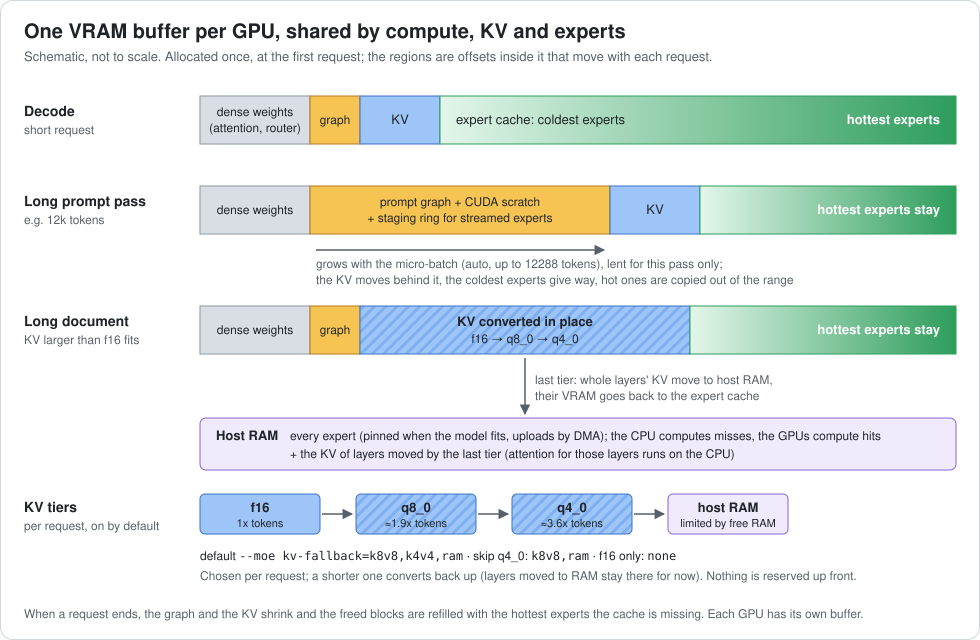

# llama.cpp: fork with multi gpu acceleration even for models bigger than total gpu mem

For MoE models larger than VRAM: every expert stays in system RAM, and all VRAM left
after the KV cache becomes a live cache of the experts actually being used. The GPUs
compute cached experts while the CPU computes the rest, in parallel.

llama-server -m GLM-5.3-Flash-GSQ-RCO-3.0bit-q4kattn.gguf

## How it works



- **Expert cache.** All experts stay in RAM; each GPU's free VRAM is one buffer of expert blocks. The GPUs compute the cached (hot) experts while the CPU computes the misses, in parallel. A missed expert that keeps being used is uploaded and replaces a colder one. It started from the expert cache of llama.cpp PR #27861, then changed in two ways: LRU eviction was replaced by a window of recent use plus admission (a missed expert takes a slot only after repeated use within the last 64 tokens), and the fixed reserve per layer was replaced by one global pool of expert blocks shared by all layers.
- **Learned hot experts, kept between runs.** Per model, the lifetime use of every expert is saved in `moe-state.ini` (`~/.cache/llama.cpp/`, Windows `%LOCALAPPDATA%\llama.cpp\`) and updated by every run; the next start preloads the hottest experts. The first run or two of a new model are slower (it is a cache). A pre-warmed state for the models in the table is in the repo: copy [fork/moe-state.ini](fork/moe-state.ini) there if you have none.
- **Prompts in few big passes.** Every prompt pass streams the experts the GPU does not hold, so the micro-batch (`-ub`) is sized per request (up to 12288 tokens) and the graph borrows expert blocks only for that pass; decode gets them back.
- **The biggest VRAM efficiency change: a big micro-batch is no longer dead weight.** With a static `-ub`, the compute buffer of the largest micro-batch stays reserved through the whole session. A small `-ub` left the VRAM to the expert cache: great decode, weak prompt processing. A big `-ub` (4k, 8k, 12k) gave massive prompt processing but low decode, because the buffer left no room for the expert cache in the decode phase. Here the big buffer is lent only to the prompt pass. When the pass ends, that space goes back to the expert cache, refilled with the globally hot experts of the model (from `moe-state.ini`) and with the coldest ones the prompt pass has just used (prefill preheat), so decode starts with a full cache. So one expert cache is reused across the prompt and decode phases: the experts that stay resident serve the prompt pass too, and the blocks lent to it are rehydrated when decode begins. The refill continues during decode, so the longer the answer (past about 1k tokens), the closer decode speed gets to a run without a big prompt before it. This is the design expectation; I have not yet measured the recovery curve token by token.
- **KV inside the same buffer.** With `-np 1` no context is reserved: each request claims the KV it needs and gives it back at its end, so a big `-c` costs nothing. A request whose KV does not fit in f16 converts it in place to q8_0, then q4_0, then moves whole layers' KV to host RAM. On by default (`--moe kv-fallback=k8v8,k4v4,ram`); skip q4_0 with `--moe kv-fallback=k8v8,ram` (q8_0 KV measured within noise of f16: OLMoE perplexity 2.1926 vs 2.1946; q4_0 +0.58%), turn it off with `--moe kv-fallback=none`.
- **Two GPUs.** A planner picks per prompt size one card or a split of the dense layers over both, from measured link speed and compute.

Every setting and its default: [fork/docs/fork-knobs.md](fork/docs/fork-knobs.md). Internals and measurements per feature: [fork/docs/features.md](fork/docs/features.md).

## Best gainers


One run of ours (the run with the biggest single gain among the three builds, against the one official at that point newest stock (b11742, 2026-10-20) run closest to stock's median; every number is from those two runs, whose answers are in the output column (ours on top, stock below, so you can open both). Sorted by the bigger gain; rows where neither gain reaches +10% are left out (models that fit in VRAM and the dense 27B models run at stock speed). Upper number stock, lower ours. **12k/1k** = 12.4k-13.8k-token code-review prompt, 1024 tokens out; **3k/1k** = ~3k-token source file plus an edit instruction, answer up to 1024 tokens; **short/1k** = one-line prompt, 1024 tokens out (no prompt speed: too short to time). t/s = decode, pp = prompt processing, ppl = perplexity on b13600 (details below). Valid = same power limits as stock (x4 card 220 W, x16 card 280 W), answer not looped, decode only from answers of 256+ tokens. 2x RTX 3090 (x16 + x4), Ryzen 7 3700X, 128 GB DDR4-3200.

| model | test | t/s | pp | gain t | gain pp | ppl | build | output |
|---|---|---|---|---|---|---|---|---|
| MiMo 2.6F 3-bit | 12k/1k | 14.2<br>23.5 | 49<br>1022 | +66% | +1975% 20.8x | 1.8758<br>1.8758 | b13600 | [17121](fork/outputs/17121.txt)<br>[17118s](fork/outputs/17118s.txt) |
| MiMo 2.6F 3-bit | 3k/1k | 14.3<br>26.1 | 48<br>740 | +82% | +1432% 15.3x | 1.8758<br>1.8758 | b13586 | [16785](fork/outputs/16785.txt)<br>[17122s](fork/outputs/17122s.txt) |
| GLM 5.3 3-bit | 12k/1k | 12.9<br>19.0 | 42<br>627 | +47% | +1378% 14.8x | 1.7626<br>1.7578 | b13586 | [16725](fork/outputs/16725.txt)<br>[17130s](fork/outputs/17130s.txt) |
| GLM 5.3 3-bit | 3k/1k | 12.7<br>20.3 | 40<br>585 | +59% | +1363% 14.6x | 1.7626<br>1.7578 | b13600 | [17137](fork/outputs/17137.txt)<br>[17135s](fork/outputs/17135s.txt) |
| GLM 5.3 3.5-bit* | 3k/1k | 10.7<br>12.9 | 30<br>224 | +21% | +647% 7.5x | 1.6326<br>1.6265 | b13563 | [16756](fork/outputs/16756.txt)<br>[17146s](fork/outputs/17146s.txt) |
| Qwen 3.8 Next IQ4_XS | 12k/1k | 32.0<br>50.4 | 208<br>1483 | +58% | +611% 7.1x | 1.4101<br>1.4101 | b13600 | [17109](fork/outputs/17109.txt)<br>[17106s](fork/outputs/17106s.txt) |
| GLM 5.3 3.5-bit* | 12k/1k | 10.8<br>11.0 | 34<br>230 | +2% | +572% 6.7x | 1.6326<br>1.6265 | b13563 | [16759](fork/outputs/16759.txt)<br>[17143s](fork/outputs/17143s.txt) |
| Qwen 3.8 Next IQ4_XS | 3k/1k | 31.2<br>53.6 | 206<br>1240 | +72% | +503% 6.0x | 1.4101<br>1.4101 | b13600 | [17113](fork/outputs/17113.txt)<br>[17110s](fork/outputs/17110s.txt) |
| Qwen 3.8 Next IQ3_S | 12k/1k | 43.8<br>53.6 | 372<br>1477 | +22% | +297% 4.0x | 1.3927<br>1.3927 | b13586 | [16719](fork/outputs/16719.txt)<br>[17094s](fork/outputs/17094s.txt) |
| Qwen 3.8 Next IQ3_S | 3k/1k | 43.7<br>55.8 | 387<br>1254 | +27% | +224% 3.2x | 1.3927<br>1.3927 | b13600 | [17101](fork/outputs/17101.txt)<br>[17099s](fork/outputs/17099s.txt) |
| MiMo 2.6F 3-bit | short/1k | 14.3<br>33.1 | -<br>- | +131% 2.3x | - | 1.8758<br>1.8758 | b13600 | [17128](fork/outputs/17128.txt)<br>[17126s](fork/outputs/17126s.txt) |
| Qwen 3.8 Next IQ4_XS | short/1k | 30.9<br>55.1 | -<br>- | +78% | - | 1.4101<br>1.4101 | b13586 | [16788](fork/outputs/16788.txt)<br>[17114s](fork/outputs/17114s.txt) |
| GLM 5.3 3-bit | short/1k | 12.8<br>20.8 | -<br>- | +62% | - | 1.7626<br>1.7578 | b13600 | [17141](fork/outputs/17141.txt)<br>[17139s](fork/outputs/17139s.txt) |
| GLM 5.3 3.5-bit* | short/1k | 10.8<br>14.9 | -<br>- | +37% | - | 1.6326<br>1.6265 | b13563 | [16687](fork/outputs/16687.txt)<br>[17151s](fork/outputs/17151s.txt) |
| Qwen 3.8 Next IQ3_S | short/1k | 43.5<br>56.9 | -<br>- | +31% | - | 1.3927<br>1.3927 | b13563 | [16766](fork/outputs/16766.txt)<br>[17102s](fork/outputs/17102s.txt) |

\* GLM 3.5-bit (127.7 GiB) is larger than this machine's 128 GB RAM, so part of it runs from the SSD and the system swaps (up to about 4 GiB of swap in use during runs). Ours is faster than stock despite that.  

Every answer behind the table is in [fork/outputs](fork/outputs) as `<id>.txt` (header: build, test, speeds, arguments, power); stock's answers as `<id>s.txt`. With the run database: `python3 fork/run.py out ID` (get it with `git fetch https://github.com/neurall/llama.cpp runs-db && git show FETCH_HEAD:runs.db > fork/runs.db`).

Our builds in the table are b13600 and two earlier builds of this release line (b13563, b13586); each cell shows the build with the best run. Older tables (earlier releases, laptop and CPU rows): [fork/docs/perf-history.md](fork/docs/perf-history.md).

### Reproduce a row

1. Binaries: ours [`llama-release-b13600-c1d4fe980-bin-ubuntu-cuda-13.4-x64.tar.gz`](https://github.com/neurall/llama.cpp/releases/download/release-b13600-c1d4fe980-dynamic-ctx/llama-release-b13600-c1d4fe980-bin-ubuntu-cuda-13.4-x64.tar.gz) (Windows zip on the [release page](https://github.com/neurall/llama.cpp/releases/tag/release-b13600-c1d4fe980-dynamic-ctx); add the `cudart-` archive if CUDA 13 is not installed); stock: `llama-b11742-bin-ubuntu-cuda-13.4-x64.tar.gz` from [ggml-org b11742](https://github.com/ggml-org/llama.cpp/releases/tag/b11742).
2. Start the server (port 9931). The `-c` values are the ones the table's runs used:

| test | ours | stock |
|---|---|---|
| 12k/1k | `llama-server -m MODEL -np 1` | `llama-server -m MODEL -np 1 -c 16384` |
| 3k/1k | `llama-server -m MODEL -np 1 -c 4096` | `llama-server -m MODEL -c 4096` |
| short/1k | `llama-server -m MODEL -np 1 -c 1024` | `llama-server -m MODEL -c 1024` |

   GLM 5.3 3.5-bit (137 GB) is larger than the 128 GB RAM here; our rows ran with `-lm mmap --moe pin-budget=108447924224` added (pin 101 GiB, map the rest).
3. Send the exact request the harness sends ([fork/bench/req-*.json](fork/bench): 12k-1k, 3k-1k-a / -b (the two edit instructions), short-1k), twice on the same server like the harness:
```sh
curl -sL https://raw.githubusercontent.com/neurall/llama.cpp/release/fork/bench/req-12k-1k.json | curl -s localhost:9931/v1/chat/completions -H 'Content-Type: application/json' -d @- | grep -o '"timings":{[^}]*}'
```
   `prompt_per_second` is pp, `predicted_per_second` is t/s.
4. Perplexity (same text and chunks as the table below; ours forces the expert-cache path even where the model fits VRAM):
```sh
llama-perplexity -m MODEL -f fork/bench/longsrc.cpp -c 1024 --chunks 12 -b 1024 -ub 1024 -nr                             # stock
llama-perplexity -m MODEL -f fork/bench/longsrc.cpp -c 1024 --chunks 12 -b 1024 -ub 1024 -nr --cpu-moe --moe-expert-cache -1   # ours
```

The whole table with the harness (stock and ours, 2 runs per cell, results into `fork/runs.db` and `fork/outputs/`): set the paths in [fork/local.toml.example](fork/local.toml.example) and the model files in [fork/models.ini](fork/models.ini), then the table above, biggest gains first, skipping cells that already ran today:
```sh
python3 fork/run.py run -c gainers -sc -nrt -from-best -r 2
```
`-sc` runs every cell on the newest official stock binary first (pulled, never built) and then on ours, so each row has its own stock run; `-n` lists the cells without running them; `-pl X4/X16` sets the card power limits in watts and `-nodl` skips the download of a newer stock binary. Perplexity: `python3 fork/run.py ppl -b b13600`. The table as a picture: `python3 fork/gainers_png.py`.


Models: GLM original 3.0-bit GGUF [pfeifferj/GLM-5.3-Flash-GSQ-RCO-GGUF](https://huggingface.co/pfeifferj/GLM-5.3-Flash-GSQ-RCO-GGUF)
works as-is (reference quality); the Q4_K attention variant above (same experts,
non-expert Q8_0 weights at Q4_K, +0.95% perplexity) decodes ~10% faster.

**Same VRAM, different use.** Each GLM token uses 8 of 288 experts per layer. Stock
fills VRAM with whole layers (~14 of 42), mostly experts the current token doesn't
touch, so the CPU does most expert work and the GPUs wait. This fork fills the same
VRAM with the ~100 most-used experts of every layer, so most expert work runs on the
GPUs, at the same time as the CPU handles the misses.

## What gain to expect from which model and hardware

The gain depends on how much of the model fits in VRAM. Measured on 2x RTX 3090 (48 GiB of VRAM in total), 128 GB RAM; *VRAM share* is 48 GiB divided by the model file, before the KV cache, dense weights and compute buffers take their part. Gains are against the official stock b11742, from the rows of the table above (12k prompt for prompt speed, short prompt for decode speed).

| model | file | VRAM share | prompt speed | decode speed |
|---|---|---|---|---|
| OLMoE-1B-7B Q4_K_M | 3.9 GiB | fits | - | +1% |
| Qwen3.6-35B-A3B | 11.4 GiB | fits | 1.0x | +1% |
| Qwen3.8 27B IQ4_NL (dense) | 15.2 GiB | fits | 1.0x | +0.3% |
| Qwen3.8 Next IQ1_M | 54.4 GiB | 88% | 1.04x | -0.5% |
| Qwen3.8 Next IQ3_S | 77.8 GiB | 62% | 3.9x | +31% |
| Qwen3.8 Next IQ4_XS | 87.2 GiB | 55% | 7.1x | +78% |
| MiMo-V2.6-Flash 3-bit | 107.7 GiB | 45% | 19.4x | +131% (2.3x) |
| GLM-5.3-Flash 3.0-bit | 109.4 GiB | 44% | 14.8x | +62% |
| GLM-5.3-Flash 3.5-bit* | 127.7 GiB | 38% | 6.7x | +37% |

- **MoE models whose experts don't fit in VRAM gain, for both prompt and decode speed.** Dense models and MoE models that fit fully in VRAM run at stock speed: the gains come from the expert cache and from sizing the prompt micro-batch so each expert upload serves more tokens, and a dense model has no experts to cache.
- **The less of the model fits in VRAM, the more there is to gain.** The biggest gains here are at 44-45% nominal share. Models bigger than RAM run partly from SSD, where a few extra tokens per second decide between unusable and usable: GLM 3.5-bit (127.7 GiB, larger than this machine's 128 GB RAM) still gains +21% decode and 7x prompt speed over stock on the 3k prompt (b13563). I have not yet measured models that stock runs below 5 t/s; reports are welcome.
- **On your hardware:** divide your total VRAM by the model file for the share, and expect the same shape: stock speed when it fits, the largest gains when the model fits in RAM but only a third to a half in VRAM. Only this one machine is measured so far; reports from others are welcome.

## What each feature contributes

Each row is one paired A/B on the same binary and settings, measured when the feature was added (2x RTX 3090 unless noted; older builds, one A/B each, so read them as the size of the effect, not as additive shares of the table above). Method and run notes per feature: [fork/docs/features.md](fork/docs/features.md).

| feature | test | without | with | change |
|---|---|---|---|---|
| Expert cache in free VRAM | decode, models that do not fit | stock (no expert cache) | the gainers table above | +20% to +130% decode |
| Pinned weights (server default) | GLM 12k prompt, prompt speed | 180 pp t/s | 262 pp t/s | +45% |
| | Qwen 3.8 Next 12k prompt, prompt speed | 372 pp t/s | 538 pp t/s | +45% |
| Big micro-batch (`-ub` 1024 to 4096) | GLM 12k prompt, prompt speed | 176.6 pp t/s | 370.1 pp t/s | 2.1x |
| Micro-batch buffer lent to the prompt pass only | GLM 12k prompt then decode, `-ub` 4096 | 17.81 t/s (static buffer) | 18.99 t/s | +6.6% decode, same prompt speed (368.9 vs 367.6) |
| Prefill preheat | GLM 12k prompt then 256 tokens, 1 GPU, decode | 13.5 t/s (cache hits 43%) | 15.3 t/s (55%) | +12.7% |
| Learned hot experts kept between runs | GLM first request after restart, decode | 20.5-20.9 t/s | 21.8 t/s | +4-6% |
| Global expert pool (vs fixed slots per layer) | decode with 20-35% of the experts in VRAM | 132.5-177.5 t/s | 137.3-181.7 t/s | +2.1% to +3.6% (no change when most of the model fits) |
| Dense split over two cards (forced path) | Qwen 3.8 Next 4k prompt, prompt speed, 180+220 W | 1065 and 1113 pp t/s (run ids 12190, 12191) | 1274 and 1275 pp t/s (12193, 12194) | +17% |

Which features drive which number: the **expert cache** is what lifts decode over stock; **pinned weights and the big micro-batch** (with its buffer lent only to the prompt pass, so decode keeps its cache) are what lift prompt speed. The rest are smaller, single-digit effects.

## Perplexity against stock

Same text, same chunks, official stock `llama-perplexity` against ours. The number in brackets is the per-chunk difference to stock in percent of perplexity (mean ± standard error); 0.00 means identical to four decimals. *default* is what you get without settings (the planner decides per prompt size whether to use one card or both), *one card* and *two cards* force the path (`dense-split=0` / `dense-split=1`), *dense split only* is `split-experts=0` (see below). The plain Qwen3.8 27B models are dense with no split path, so their split columns are empty. The GLM two-card cell is not measured yet. About 10 chunks of 1024 tokens per model: differences under 0.2% are inside the noise.

**What this measures.** `llama-perplexity` with 1024-token passes, so the prompt path: stock and ours both run the experts on the GPU with the same kernels there, which is why many cells are identical to four decimals (checked chunk by chunk). It does not test the decode path, where a cached expert runs on the GPU and a missed one on the CPU and the rounding differs slightly. Perplexity with one token per call exercises that path (`run ppl` can be pointed at it); between two of our own builds it differed in the 4th digit (Qwen3.6-35B: 1.5219 against 1.5209), and a decode-path comparison against stock for the models in the table has not been run yet.

| model | stock ppl | ours default | ours, one card | ours, dense split only | ours, two cards (f32 hand-offs) | chunks |
| --- | --- | --- | --- | --- | --- | --- |
| GLM-5.3-Flash-GSQ-RCO-3.0bit | 1.7626 | 1.7578 (-0.27 ± 0.18%) | 1.7599 (-0.15 ± 0.27%) | 1.7584 (-0.24 ± 0.53%) | 1.7631 (+0.03 ± 0.39%) | 9 |
| GLM-5.3-Flash-GSQ-RCO-3.5bit | 1.6326 | 1.6265 (-0.37 ± 0.20%) | 1.6260 (-0.41 ± 0.19%) | 1.6349 (+0.14 ± 0.51%) | 1.6288 (-0.23 ± 0.28%) | 9 |
| MiMo-V2.6-Flash-RL-GSQ-RCO-3bit | 1.8758 | 1.8758 (+0.00) | 1.8758 (+0.00) | 1.8736 (-0.12 ± 0.11%) | 1.8725 (-0.18 ± 0.25%) | 9 |
| OLMoE-1B-7B-0924-Q4_K_M | 2.0696 | 2.0696 (+0.00) | 2.0696 (+0.00) | 2.0688 (-0.04 ± 0.07%) | 2.0694 (-0.01 ± 0.08%) | 12 |
| Qwen3.6-35B-A3B-GSQ-hybrid | 1.7843 | 1.7843 (+0.00) | 1.7843 (+0.00) | 1.7842 (-0.01 ± 0.08%) | 1.7851 (+0.04 ± 0.07%) | 10 |
| Qwen3.8-27B-IQ4_NL | 1.6360 | 1.6360 (+0.00) | 1.6360 (+0.00) | - | - | 10 |
| Qwen3.8-27B-MTP-Q5_K_M | 1.6382 | 1.6382 (+0.00) | 1.6382 (+0.00) | - | - | 10 |
| Qwen3.8-Flash-Next-GSQ-RCO-IQ1_M-00001-of-00002 | 1.4756 | 1.4756 (+0.00) | 1.4756 (+0.00) | 1.4758 (+0.01 ± 0.17%) | 1.4745 (-0.07 ± 0.13%) | 10 |
| Qwen3.8-Flash-Next-GSQ-RCO-IQ3_S-00001-of-00002 | 1.3927 | 1.3927 (+0.00) | 1.3927 (+0.00) | 1.3969 (+0.30 ± 0.14%) | 1.3975 (+0.34 ± 0.16%) | 10 |
| Qwen3.8-Flash-Next-UD-IQ4_XS-00001-of-00003 | 1.4101 | 1.4101 (+0.00) | 1.4101 (+0.00) | 1.4114 (+0.09 ± 0.18%) | 1.4111 (+0.07 ± 0.14%) | 10 |

Measured on build b13600 (12 chunks asked, 9 to 12 used where a text ended earlier), stock is the official b11742 binary.

Reproduce: see [Reproduce a row](#reproduce-a-row), step 4.

## Run

```sh
llama-server -m GLM-5.3-Flash-GSQ-RCO-3.0bit-q4kattn.gguf
llama-cli    -m GLM-5.3-Flash-GSQ-RCO-3.0bit-q4kattn.gguf -p "hello"
```

**Automatic defaults that differ from stock llama.cpp.** They apply only when a MoE
model's weights are larger than the free VRAM of all GPUs. Other models, and every
setting you pass yourself, behave as in stock llama.cpp. The chosen values are
printed at startup (`-lv 5` prints all of them).

| setting | stock default | fork default | why |
|---|---|---|---|
| expert placement | autofit: whole layers on GPU, rest on CPU | all experts in RAM (`--cpu-moe`) | the VRAM is used for the expert cache instead of fixed layers |
| expert cache | off | fills each GPU's free VRAM (`--moe-expert-cache -1`) | holds the experts tokens actually use, so most expert work runs on the GPUs |
| CPU weight repacking | on | off (`-nr`) | repacked experts can't be copied to the GPU cache |
| `-ub` (tokens per prompt step) | 512 | calculated per request and card: candidates up to 12288, each one's compute buffer is probed and weighed against the prompt time it saves (the buffer costs expert cache VRAM); a long prompt runs as equal passes | every expert upload serves more prompt tokens: ~2x faster long prompts at a small decode cost (about -3% per doubling on GLM-5.3-Flash) |
| `-c` (context) | model maximum, fitted to VRAM | sized automatically: the largest context whose KV and context-scaled buffers take at most 30% of the expert cache VRAM, never above the model maximum; the KV moves down f16, q8_0, q4_0, host RAM if a request needs more | a bigger KV cache takes VRAM from the expert cache; `-c N` sets it yourself |
| `-t` (threads) | all physical cores | starts at physical cores minus one per GPU (6 of 8 here), then tuned on measured decode time; prompt batches tuned separately, up to the logical cores | a free core per GPU keeps kernel launches and cache uploads fast; the tuner moves the count when another one measures faster (`-at off` keeps the start value) |

Settings you pass always win, e.g. `--moe-expert-cache 0` turns the cache off. With your
own placement (`-ngl`, `-ot`, `--cpu-moe`) the cache stays off unless you also pass
`--moe-expert-cache -1`.
- **Prompt processing is placed by upload speed.** The fork measures host->GPU upload speed per GPU at startup (here x16 13.2 GB/s vs chipset x4 6.1 GB/s). For each prompt a planner picks the fastest card alone or both cards (dense layers split between them, experts streamed to one or both); layers stay in bus order.
- Output can differ between runs even at temperature 0: a cached expert runs on the
  GPU, a missed one on the CPU, and they round slightly differently. For benchmarks,
  `--moe fixed=1` makes a build repeat its output.
- Optional tuning (defaults are measured best): every setting is a `--moe` key, there are no
  environment variables for them, e.g. `vram-reserve-mb` (VRAM left free, 384), `wait-swaps`,
  `swaps-per-step`, `swap-lead`, `policy`. All keys: [fork/docs/fork-knobs.md](fork/docs/fork-knobs.md).

**More GPUs**: each GPU gets its own cache from its free VRAM, so more GPUs mean more
cached experts, fewer CPU misses and faster decode, up to the point where every
expert fits. Reports from 3+ GPU setups are welcome.

### More

Details moved to [fork/docs/features.md](fork/docs/features.md): pinned weights, persistent hot experts, prefill preheat, global expert pool, hot layers on the slower link, MTP, what's in it, known limits and next steps. Every `--moe` key: [fork/docs/fork-knobs.md](fork/docs/fork-knobs.md). Older measurements: [fork/docs/perf-history.md](fork/docs/perf-history.md).


## Known limits

- **One machine measured:** 2x RTX 3090 (x16 + x4 slots), Ryzen 7 3700X, 128 GB DDR4. Other hardware, AMD/Intel GPUs and 3+ GPUs are untested; CUDA only for now (Vulkan and AMD binaries are next, see below). Windows binaries are smoke-tested only.
- **The first runs of a model are slower.** The hot-expert state in `moe-state.ini` is learned from use (copy the pre-warmed [fork/moe-state.ini](fork/moe-state.ini) to start from it).
- **Models larger than free RAM load lazily.** The server answers while the expert weights are still being pinned in the background (about 80 s for 100 GiB), so the first big prompt after start can be several times slower than the next ones (GLM 3.5-bit, 3k prompt: 26-147 prompt t/s on the first request, 225-267 on the second request on the same server). The table shows the steady-state speed.
- **Perplexity:** within noise of stock on every model tested except Qwen 3.8 Next IQ3_S on the two-card paths (+0.3%).
- **Output can differ between runs** even at temperature 0 (a cached expert runs on the GPU, a missed one on the CPU, and they round slightly differently).
- **The gainers table takes each row from the best of three builds of this release line** (b13563, b13586, b13600); the build column says which.

## What's next

1. **Vulkan version and AMD binaries.** The top priority. Work is now allocated and scheduled dynamically from each card's compute speed and the bandwidth of the PCIe slot it sits in, so cards of different vendors should be able to share a model. In theory this works; I have not been able to test it.
2. **One pool for the expert cache and the staging buffers.** Merging the two is expected to improve VRAM efficiency further.
3. **Expert-cache lookup per topic and initialisation per request**, planned for later versions.
4. **Testing on more hardware.** Everything here was measured on one X570 board (x16 + x4 slots) with two RTX 3090s, plus a notebook with an RTX 4060. Multi-GPU setups with fast slots on every card are the most wanted: send your numbers and the startup log (`-lv 5`).

## Credits and thanks

- **Georgi Gerganov ([@ggerganov](https://github.com/ggerganov)) and every contributor to [llama.cpp](https://github.com/ggml-org/llama.cpp) and ggml**: this fork is a small layer on a fantastic project that has given so much to so many people for so many years. Thank you.
- **[@csantiago78](https://github.com/csantiago78)** and their pull request [#27861](https://github.com/ggml-org/llama.cpp/pull/27861) ("GPU-resident LRU cache for host-offloaded MoE expert weights"), the starting point of this fork's expert cache. It has since diverged (window and admission instead of LRU, one global pool instead of fixed slots per layer), but the idea and the first working version are theirs.
- **The people in that pull request's thread**, whose test reports, bug reports and questions shaped what changed:
  - [@sdroege](https://github.com/sdroege): tests on an R9700, the finding that `--fit` ignores the cache, and the VRAM released by big prompts;
  - [@sirfyyn](https://github.com/sirfyyn): Blackwell measurements and a routing trace;
  - [@Syugakubusei](https://github.com/Syugakubusei) and [@ChangXiang-SCU](https://github.com/ChangXiang-SCU): Vulkan tests on AMD cards (also two GPUs over OCuLink), the Windows build fixes, and the small-batch case for speculative decoding;
  - [@Inovello](https://github.com/Inovello): the duplicate slot id bug in the CUDA batched path, with a backend-ops test;
  - [@TacoTakumi](https://github.com/TacoTakumi), [@pwasiewi](https://github.com/pwasiewi): multi-GPU measurements and admission data;
  - [@MichaelDietzel](https://github.com/MichaelDietzel), [@Volunteer-1](https://github.com/Volunteer-1): the documentation questions (every flag is now documented in [fork/docs/fork-knobs.md](fork/docs/fork-knobs.md));
  - [@homeofe](https://github.com/homeofe): the small-VRAM data point (the case where the cache was slower than stock) and the AVX2 dot products for IQ3_S and IQ3_XXS (`ggml-cpu`), merged into this fork (MIT license);
  - [@yuffx](https://github.com/yuffx), [@nilo85](https://github.com/nilo85), [@Interpause](https://github.com/Interpause): the PCIe-bound explanation, the profile and auto-tune idea, and pointers to related discussions;
  - and for testing and feedback [@XBold](https://github.com/XBold), [@nasone32](https://github.com/nasone32), [@mobilinkd](https://github.com/mobilinkd), [@arthw](https://github.com/arthw), [@mtrx93](https://github.com/mtrx93), [@feal87](https://github.com/feal87), [@dany-on-demand](https://github.com/dany-on-demand), [@momcilovicrobert-momc](https://github.com/momcilovicrobert-momc), [@pjsgsy](https://github.com/pjsgsy), [@jintakhan](https://github.com/jintakhan), [@GlassOnTin](https://github.com/GlassOnTin), [@logari81](https://github.com/logari81), [@voidpush](https://github.com/voidpush), [@simlu](https://github.com/simlu), [@SladeThe](https://github.com/SladeThe), [@TheTom](https://github.com/TheTom).

---

*The original llama.cpp README follows below.*

---

# llama.cpp


<div align="center">

<b>LLM inference in C/C++</b>

[](https://opensource.org/licenses/MIT)
[](https://github.com/ggml-org/llama.cpp/releases?q=tag:v0)
[](https://github.com/ggml-org/llama.cpp/releases?q=b)
[](https://github.com/ggml-org/llama.cpp/actions/workflows/server.yml)
[](https://github.com/ggml-org/llama.cpp/actions/workflows/docker.yml)
[](https://github.com/ggml-org/llama.cpp/actions/workflows/winget.yml)

[ggml](https://github.com/ggml-org/ggml) / [ops](https://github.com/ggml-org/llama.cpp/blob/master/docs/ops.md) / [maintainer PRs](https://github.com/ggml-org/llama.cpp/issues?q=is%3Apr%20is%3Aopen%20draft%3AFalse%20(author%3Argerganov%20OR%20author%3AKitaitiMakoto%20OR%20author%3Adanbev%20OR%20author%3Aaldehir%20OR%20author%3Amax-krasnyansky%20OR%20author%3ACISC%20OR%20author%3Aggerganov%20OR%20author%3Aam17an%20OR%20author%3Ajhen0409%20OR%20author%3Abartowski1182%20OR%20author%3Anikwen%20OR%20author%3Ahipudding%20OR%20author%3Aravi9%20OR%20author%3AServeurpersoCom%20OR%20author%3Apwilkin%20OR%20author%3Areeselevine%20OR%20author%3Angxson%20OR%20author%3Ajeffbolznv%20OR%20author%3Amarty1885%20OR%20author%3A0cc4m%20OR%20author%3ATitaniumtown%20OR%20author%3Aangt%20OR%20author%3AIMbackK%20OR%20author%3Aarthw%20OR%20author%3AJohannesGaessler%20OR%20author%3AORippler%20OR%20author%3Aruixiang63%20OR%20author%3Axctan%20OR%20author%3Aallozaur%20OR%20author%3Ayomaytk%20OR%20author%3Aaendk%20OR%20author%3Awine99%20OR%20author%3Agaugarg-nv%20OR%20author%3Ataronaeo%20OR%20author%3Aforforever73%20OR%20author%3Alhez%20OR%20author%3Anetrunnereve%20OR%20author%3Afairydreaming)%20sort%3Aupdated-desc) / [dev stats](https://github.com/ggml-org/llama.cpp-dev) / [lib llama API](https://github.com/ggml-org/llama.cpp/issues/9289) / [llama-server REST API](https://github.com/ggml-org/llama.cpp/issues/9291)

</div>

## Quick start

A few options to get `llama.cpp` installed on your machine:

```bash
# curl
curl -LsSf https://llama.app/install.sh | sh

# powershell
irm https://llama.app/install.ps1 | iex
```

- Visit https://llama.app and follow the instructions
- Run with Docker - see our [Docker documentation](docs/docker.md)
- Download pre-built binaries from the [releases page](https://github.com/ggml-org/llama.cpp/releases)
- Build from source by cloning this repository - check out [our build guide](docs/build.md)

Once installed:

```sh
# Download and run a model directly from Hugging Face
llama cli -hf ggml-org/Qwen3.5-0.8B-GGUF

# Launch OpenAI-compatible API server
llama serve -hf ggml-org/Qwen3.5-0.8B-GGUF
```

<table align="center">
    <tr>
        <td align="center" width=50%>
            
            <i>VLM session with <b>llama cli</b></i>
        </td>
        <td align="center">
            
            <i>Built-in web UI against <b>llama serve</b></i>
        </td>
    </tr>
<table>

## Description

The main goal of `llama.cpp` is to enable LLM (and VLM) inference with minimal setup and state-of-the-art performance on
a wide range of hardware - locally and in the cloud.

- Plain C/C++ implementation without any dependencies
- Apple silicon is a first-class citizen - optimized via ARM NEON, Accelerate and Metal frameworks
- AVX, AVX2, AVX512 and AMX support for x86 architectures
- RVV, ZVFH, ZFH, ZICBOP and ZIHINTPAUSE support for RISC-V architectures
- 1.5-bit, 2-bit, 3-bit, 4-bit, 5-bit, 6-bit, and 8-bit integer quantization for faster inference and reduced memory use
- Custom CUDA kernels for running LLMs on NVIDIA GPUs (support for AMD GPUs via HIP and Moore Threads GPUs via MUSA)
- Vulkan and SYCL backend support
- CPU+GPU hybrid inference to partially accelerate models larger than the total VRAM capacity

The `llama.cpp` project is build on top of the [ggml](https://github.com/ggml-org/ggml) library.

## Supported backends

| Backend | Target devices |
| --- | --- |
| [BLAS](docs/build.md#blas-build) | All |
| [BLIS](docs/backend/BLIS.md) | All |
| [CANN](docs/build.md#cann) | Ascend NPU |
| [CUDA](docs/build.md#cuda) | Nvidia GPU |
| [HIP](docs/build.md#hip) | AMD GPU |
| [Hexagon](docs/backend/snapdragon/README.md) | Snapdragon |
| [IBM zDNN](docs/backend/zDNN.md) | IBM Z & LinuxONE |
| [MUSA](docs/build.md#musa) | Moore Threads GPU |
| [Metal](docs/build.md#metal-build) | Apple Silicon |
| [OpenCL](docs/backend/OPENCL.md) | Adreno GPU |
| [OpenVINO [In Progress]](docs/backend/OPENVINO.md) | Intel CPUs, GPUs, and NPUs |
| [RPC](https://github.com/ggml-org/llama.cpp/tree/master/tools/rpc) | All |
| [SYCL](docs/backend/SYCL.md) | Intel GPU |
| [VirtGPU](docs/backend/VirtGPU.md) | VirtGPU APIR |
| [Vulkan](docs/build.md#vulkan) | GPU |
| [WebGPU](docs/build.md#webgpu) | All |
| [ZenDNN](docs/build.md#zendnn) | AMD CPU |

## Documentation

#### Tools

- [cli](tools/cli/README.md)
- [completion](tools/completion/README.md)
- [server](tools/server/README.md)
- [GBNF grammars](grammars/README.md)

#### Development

- [How to build](docs/build.md)
- [Running on Docker](docs/docker.md)
- [Build on Android](docs/android.md)
- [Multi-GPU usage](docs/multi-gpu.md)
- [Performance troubleshooting](docs/development/token_generation_performance_tips.md)
- [GGML tips & tricks](https://github.com/ggml-org/llama.cpp/wiki/GGML-Tips-&-Tricks)
- [XCFramework](docs/xcframework.md)
- [Completions](docs/completions.md)
- [Models](docs/models.md)
- [Release process](docs/release.md)

## Contributing

- Contributors can open PRs
- Collaborators will be invited based on contributions
- Maintainers can push to branches in the `llama.cpp` repo and merge PRs into the `master` branch
- Any help with managing issues, PRs and projects is very appreciated!
- Read the [CONTRIBUTING.md](CONTRIBUTING.md) for more information

## Acknowledgements

- [yhirose/cpp-httplib](https://github.com/yhirose/cpp-httplib) - Single-header HTTP server, used by `llama-server` - MIT license
- [nothings/stb](https://github.com/nothings/stb) - Single-header image format decoder, used by multimodal subsystem - Public domain
- [nlohmann/json](https://github.com/nlohmann/json) - Single-header JSON library, used by various tools/examples - MIT License
- [mackron/miniaudio](https://github.com/mackron/miniaudio) - Single-header audio format decoder, used by multimodal subsystem - Public domain
- [sheredom/subprocess.h](https://github.com/sheredom/subprocess.h) - Single-header process launching solution for C and C++ - Public domain
